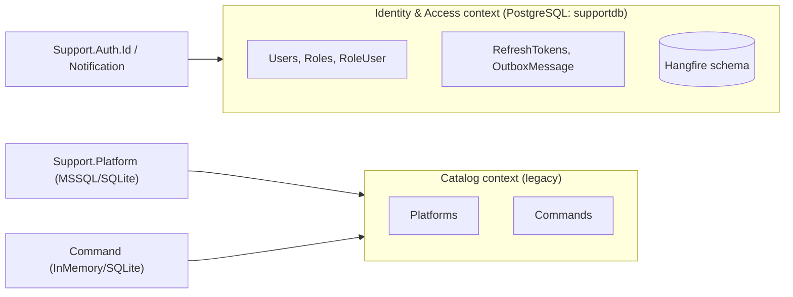
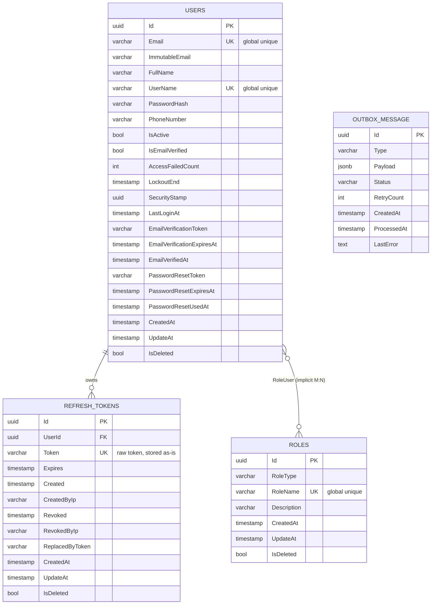
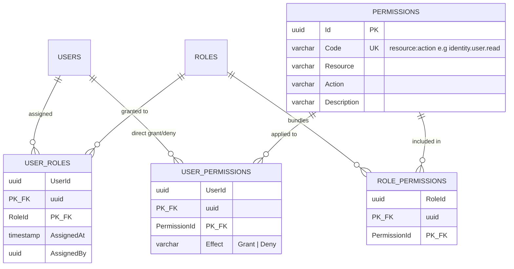
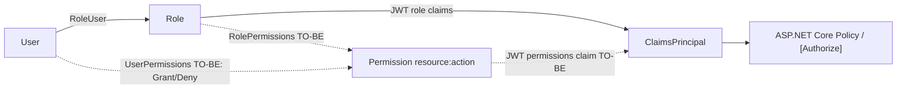
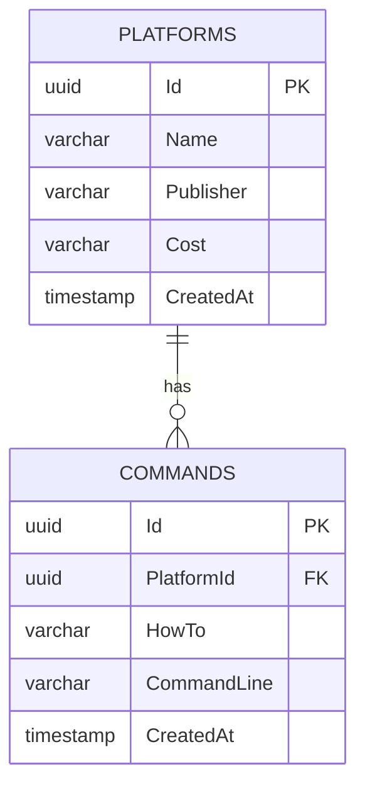

# Physical Database Model (ERD)

> **Part 1 of 4** — split from [`ARCHITECTURE.md`](ARCHITECTURE.md).
> **Status:** AS-IS (verified against the code) plus optional non-tenant TO-BE improvements.
> **Database:** PostgreSQL (`supportdb`) for Identity & Access; the legacy catalog context uses SQL Server/InMemory.

This document covers the tables, primary keys (PK), foreign keys (FK), indexes, and relationships of the Identity & Access module. Tenancy is **single-tenant**: there is no `Tenants` table and no `TenantId` column anywhere in the code.

**Related:** [Component Architecture](02-COMPONENT-ARCHITECTURE.md) · [Data Flow & Security](03-DATA-FLOW-SECURITY.md) · [Infrastructure & Deployment](04-INFRASTRUCTURE-DEPLOYMENT.md)

---

## 1.1 Bounded contexts and data ownership

- **AS-IS:** one shared PostgreSQL database `supportdb` for Auth + Hangfire; Platform on SQL Server; Command on InMemory.
- **Tenancy:** **single-tenant**. There is exactly one user population per deployment; the code contains **no** `Tenants` table, `TenantId` column, `ITenantContext`, or tenant query filter. Uniqueness of `Email`, `UserName`, and `RoleName` is **global**. Adding multi-tenancy would be a future product decision, not an existing requirement.
- Catalog context remains a separate legacy store (recommended: migrate `Command` to a durable database per environment).

## 1.2 ERD — Identity & Access (AS-IS, verified from code)

> `RoleUser` is created implicitly by EF Core (`HasMany(...).WithMany(...)`) and carries only `RolesId` + `UsersId` (composite PK). There is **no** permissions table and **no** audit table in the current code. `OutboxMessage` exists but its worker is disabled.

## 1.3 Table catalog (AS-IS, PostgreSQL)

### `Users`
| Column | Type | Key/Constraint |
|---|---|---|
| Id | uuid | **PK** |
| Email | varchar(100) | not null; **unique (global)** |
| ImmutableEmail | varchar(100) | not null (audit of original email) |
| UserName | varchar(50) | not null; **unique (global)** |
| FullName | varchar(100) | not null |
| PasswordHash | varchar(500) | not null (BCrypt) |
| PhoneNumber | varchar(30) | null |
| IsActive | boolean | not null, default true (account enabled) |
| IsEmailVerified | boolean | not null, default false |
| AccessFailedCount | int | not null, default 0 |
| LockoutEnd | timestamptz | null |
| SecurityStamp | uuid | not null (session invalidation) |
| LastLoginAt | timestamptz | null |
| EmailVerificationToken | varchar(225) | owned value object (`EmailVerification`) |
| EmailVerificationExpiresAt | timestamptz | owned |
| EmailVerifiedAt | timestamptz | owned |
| PasswordResetToken | varchar(225) | owned value object (`PasswordReset`) |
| PasswordResetExpiresAt | timestamptz | owned |
| PasswordResetUsedAt | timestamptz | owned |
| CreatedAt | timestamptz | not null |
| UpdateAt | timestamptz | null (note: property name is `UpdateAt`, not `UpdatedAt`) |
| IsDeleted | boolean | not null, default false |

Indexes: `IX_Users_UserName` **unique**, `IX_Users_Email` **unique** (both global and **not** filtered by `IsDeleted`). Query filter: `IsDeleted = false` (read path only).

### `Roles`
| Column | Type | Key/Constraint |
|---|---|---|
| Id | uuid | **PK** |
| RoleType | varchar(50) | not null |
| RoleName | varchar(100) | not null; **unique (global)** |
| Description | varchar(100) | null |
| CreatedAt | timestamptz | not null |
| UpdateAt | timestamptz | null |
| IsDeleted | boolean | not null, default false |

Index: `IX_Roles_RoleName` **unique**. Query filter: `IsDeleted = false`. No `IsSystem` column exists yet.

### `RoleUser` (implicit M:N)
| Column | Type | Key/Constraint |
|---|---|---|
| RolesId | uuid | **PK**, **FK → Roles(Id)** |
| UsersId | uuid | **PK**, **FK → Users(Id)** |

Created by EF convention (`RolesId`/`UsersId` are the default column names for this navigation shape); no payload columns (`AssignedAt`/`AssignedBy` do not exist). Index: `IX_RoleUser_UsersId`.

### `RefreshTokens`
| Column | Type | Key/Constraint |
|---|---|---|
| Id | uuid | **PK** |
| UserId | uuid | **FK → Users(Id)**, `ON DELETE RESTRICT` |
| Token | varchar(500) | not null; **unique** — raw token stored as-is (no hashing yet) |
| Expires | timestamptz | not null |
| Created | timestamptz | not null |
| CreatedByIp | varchar(100) | not null |
| Revoked | timestamptz | null |
| RevokedByIp | varchar(100) | null |
| ReplacedByToken | varchar(500) | null (rotation chain) |
| CreatedAt | timestamptz | not null |
| UpdateAt | timestamptz | null |
| IsDeleted | boolean | not null, default false (no query filter registered) |

Index: `IX_RefreshTokens_Token` **unique**.

### `OutboxMessage` (transactional outbox, worker currently disabled)
| Column | Type | Key/Constraint |
|---|---|---|
| Id | uuid | **PK** |
| Type | varchar(100) | not null |
| Payload | jsonb | not null |
| Status | varchar(20) | not null, default `Pending` |
| RetryCount | int | not null, default 0 |
| CreatedAt | timestamptz | not null, default `CURRENT_TIMESTAMP` |
| ProcessedAt | timestamptz | null |
| LastError | text | null |

Indexes: `IDX_OutboxMessages_Type`, `IDX_OutboxMessages_Status_CreatedAt`. Table name is singular (`OutboxMessage`).

### Hangfire schema
Managed by Hangfire.PostgreSql in the same database — **do not** hand-modify. Consider a dedicated schema (`hangfire`) and a separate database for isolation in production.

## 1.4 Single-tenancy & data isolation (AS-IS)

- **Model:** one installation serves one user population; the database is shared only across the application's own modules.
- **Isolation mechanism:** none is required beyond the `IsDeleted = false` global query filter on `User` and `Role`. There is no tenant discriminator, interceptor, or tenant-resolution service.
- **Uniqueness:** `Email`, `UserName`, and `RoleName` are globally unique indexes.
- **Implication:** if multi-tenancy is ever required (e.g. one deployment serving many customer organizations), it is a **new feature** that needs: `Tenants` table, `TenantId` on users/roles/tokens/outbox, global query filters, a tenant resolver, and composite unique keys. Do not document or implement it before that decision is made.

## 1.5 TO-BE improvements (optional, non-tenant)

These are the only target changes; **none of them add tenancy**.

| Improvement | Target | Why |
|---|---|---|
| Permission model | `Permissions`, `RolePermissions`, `UserPermissions` | fine-grained authorization on top of existing roles |
| Explicit join table | `UserRoles` with `AssignedAt`/`AssignedBy` | auditable role assignment (replaces implicit `RoleUser`) |
| Refresh token hardening | `TokenHash` (SHA-256) instead of raw `Token`; rotation + reuse detection | a DB leak must not expose usable tokens |
| Audit trail | `AuditLogs` (`ActorUserId`, `EventType`, `EntityType`, `EntityId`, `Metadata`, `IpAddress`, `OccurredAt`) | security forensics |
| Soft-delete-safe unique keys | filtered unique indexes `WHERE IsDeleted = false` | current global unique index still blocks re-registration after soft delete |
| Outbox activation | rename `OutboxMessage` → `OutboxMessages`, enable `OutboxWorkerService` | remove dual-write between DB commit and email enqueue |

## 1.6 Access control model (RBAC now — permissions TO-BE)

- **AS-IS (implemented):** users → roles only. `TokenGenerator` emits one `ClaimTypes.Role` claim per role (`sub`, `email`, `unique_name`, `jti`, `role`). Authorization uses role-based policies such as `[Authorize(Policy = "Admin")]`.
- **TO-BE:** flatten effective permissions into a `permissions` claim and enforce with a `PermissionAuthorizationHandler` + `[HasPermission("identity.user.read")]`; existing role policies stay for backward compatibility.
- **Deny precedence (TO-BE):** `UserPermissions.Effect = Deny` overrides grants.

## 1.7 AS-IS → TO-BE delta (Identity context)

| Item | AS-IS | TO-BE |
|---|---|---|
| Tenancy | single-tenant, no `TenantId` | unchanged (no multi-tenancy planned) |
| Join table | implicit `RoleUser` | explicit `UserRoles` (+ AssignedAt/AssignedBy) |
| Permissions | none | `Permissions`, `RolePermissions`, `UserPermissions` |
| Refresh token storage | plaintext `Token` | `TokenHash` (SHA-256) |
| Email verified flag | `IsEmailVerified` + owned `EmailVerifiedAt` (duplicate) | derive one from `EmailVerifiedAt` |
| Unique indexes | global `IX_Users_Email` / `IX_Users_UserName` (unfiltered) | keep global, make filtered `WHERE IsDeleted = false` |
| Audit | none | `AuditLogs` |
| Outbox | table `OutboxMessage` exists, worker disabled | renamed `OutboxMessages`, promoted to active delivery mechanism |

## 1.8 ERD — Catalog context (legacy, AS-IS)

> `Support.Platform` uses SQL Server (prod) / InMemory (dev); `Command` uses InMemory. TO-BE recommendation: give both a durable store (PostgreSQL to consolidate the stack). The catalog is **not** tenant-scoped.
