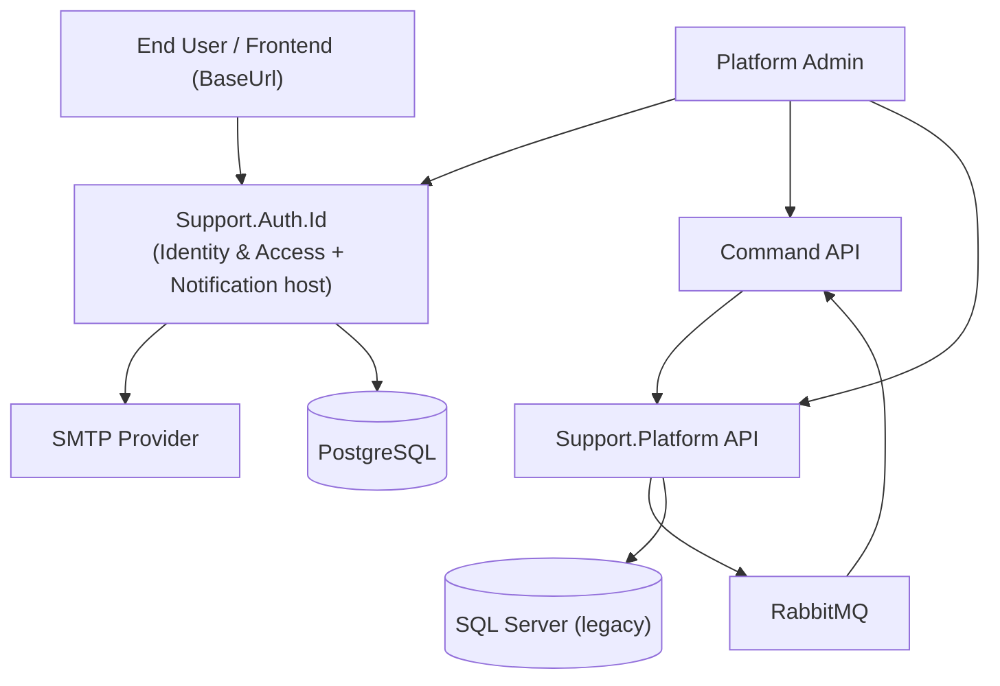
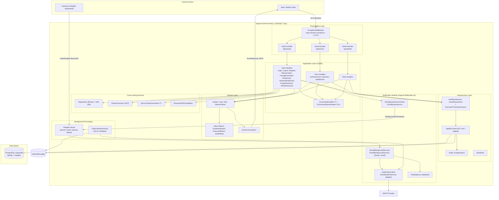
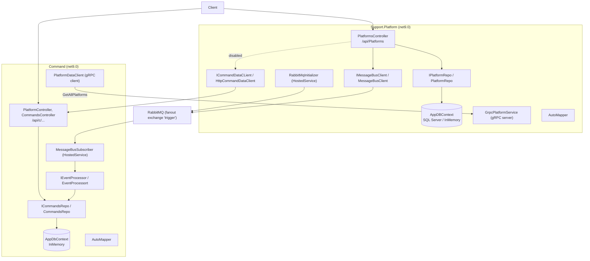

# Component Architecture (C4 Level 3)

> **Part 2 of 4** — split from [`ARCHITECTURE.md`](ARCHITECTURE.md).
> **Status:** AS-IS component structure (verified against the code).
> **Scope:** `Support.Auth.Id` + hosted Notification module, and the legacy `Support.Platform` / `Command` subsystem.

This document shows how the layers and modules of the .NET application and its internal services are structured, including presentation, application/CQRS, domain, infrastructure, cross-cutting services, and background processing.

**Related:** [Database Model](01-DATABASE-MODEL.md) · [Data Flow & Security](03-DATA-FLOW-SECURITY.md) · [Infrastructure & Deployment](04-INFRASTRUCTURE-DEPLOYMENT.md)

---

## 2.1 C4 Level 1 — System Context

## 2.2 C4 Level 3 — `Support.Auth.Id` (+ hosted Notification module)

**Component responsibilities**

| Component | Responsibility | Key files |
|---|---|---|
| `ExceptionMiddleware` | Global error handling; typed exception → HTTP (404/409/401/400/500) + `ErrorResponse` with TraceId | `src/Middleware/ExceptionMiddleware.cs` |
| Controllers | HTTP boundary, model validation, dispatch to handlers; no business logic | `src/Controller/*.cs` |
| CQRS Handlers | Orchestration, transaction boundary (`ExecuteInTransactionAsync`) | `src/Features/Handler/**` |
| Domain entities | Invariants, factories, state transitions | `src/Domain/Entity/*.cs` |
| Value objects | Immutable sub-values, owned by `User` | `src/Domain/ValueObject/*.cs` |
| `AuthRepositories` | EF Core data access + transaction | `src/Repositories/*` |
| `AppDbContext` | EF model, query filters, configurations | `src/Repositories/Data/*` |
| `TokenGenerator` | JWT access token + refresh token creation | `src/Services/Security/TokenGenerator.cs` |
| `AppHasher` | BCrypt (password) + SHA-256 (token hash) | `src/Services/Security/PasswordHasher.cs` |
| `EmailQueueService` | Enqueue Hangfire email job | `Support.Notification.Id/src/Services/EmailQueueService.cs` |
| `EmailBackgroundServices` | Hangfire job `[Queue("email")]` → MailKit | `.../BackgroundServices/EmailBackgroundServices.cs` |
| `EmailSenderServices` | SMTP send (`INotificationClient`) | `.../Services/EmailSenderServices.cs` |
| `Hangfire Server` | Executes queued jobs; dashboard at `/auth/hangfire` | `Program.cs` |
| `OutboxWorkerService` | Poll outbox, deliver via `INotificationClient` | `src/Services/BackgroundServices/OutboxWorkerService.cs` |

## 2.3 C4 Level 3 — Legacy subsystem (`Support.Platform` + `Command`)

