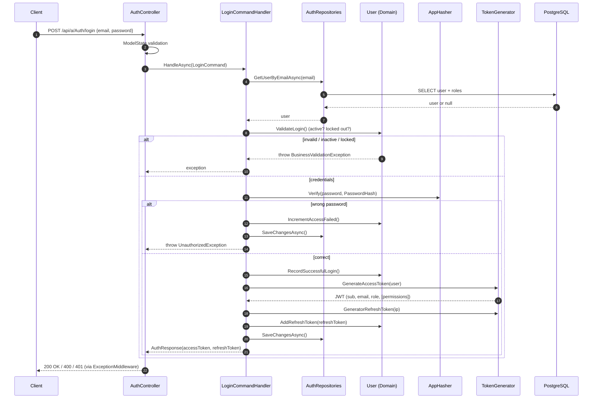
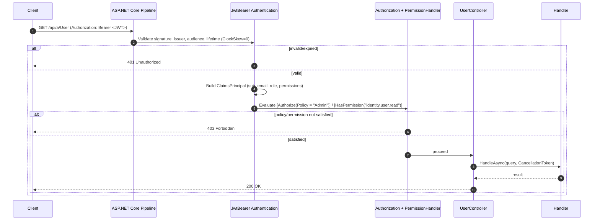
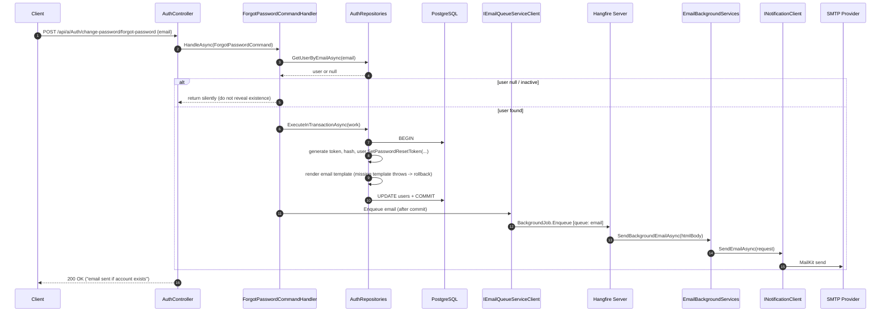
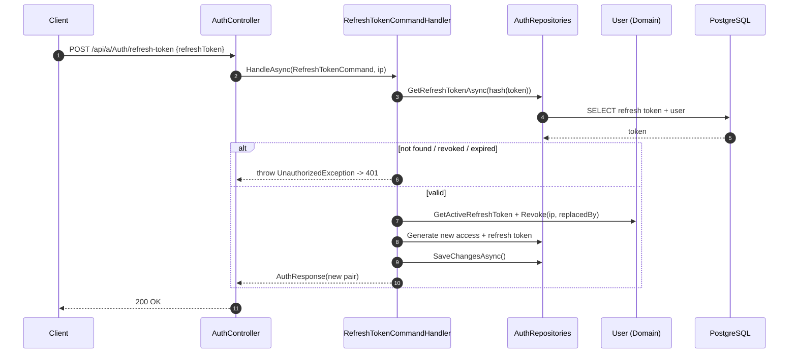
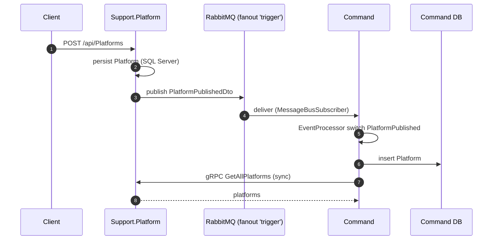

# Data Flow & Security Sequence Diagrams

> **Part 3 of 4** — split from [`ARCHITECTURE.md`](ARCHITECTURE.md).
> **Status:** AS-IS flows (verified against the code); TO-BE additions are marked as such.
> **Scope:** login and token issuance, authorization checks, password reset, token rotation, registration/verification, and cross-service messaging.

This document illustrates the operational and security flows from request to response, including JWT handling, RBAC authorization, and background email delivery.

**Related:** [Database Model](01-DATABASE-MODEL.md) · [Component Architecture](02-COMPONENT-ARCHITECTURE.md) · [Infrastructure & Deployment](04-INFRASTRUCTURE-DEPLOYMENT.md)

---

## 3.1 Login + token issuance (AS-IS logic, TO-BE adds the `permissions` claim)



## 3.2 Authorization check on a protected endpoint (RBAC + permission)



## 3.3 Forgot password (transactional side-effect via Hangfire)



> Reliability note: the enqueue happens **after** commit. TO-BE strengthens this with the **transactional outbox** (write `OutboxMessage` in the same transaction; a worker publishes to Hangfire), eliminating the dual-write window.

## 3.4 Refresh token rotation



## 3.5 Registration + email verification

```mermaid
sequenceDiagram
  autonumber
  participant C as Client
  participant AC as AuthController
  participant RH as RegisterCommandHandler
  participant R as AuthRepositories
  participant DB as PostgreSQL
  participant HF as Hangfire (email queue)
  participant SMTP as SMTP

  C->>AC: POST /api/a/Auth/register
  AC->>RH: HandleAsync(RegisterCommand)
  RH->>R: IsUserEmailExists / IsUsernameExists
  RH->>R: ExecuteInTransactionAsync
  R->>DB: BEGIN; INSERT user + role; set verification token; COMMIT
  RH->>HF: enqueue verification email
  HF->>SMTP: send
  AC-->>C: 200 OK
  C->>AC: POST /api/a/Auth/verify-email {token}
  AC->>R: GetUserByEmailVerificationTokenAsync(token)
  AC->>DB: UPDATE email verified
  AC-->>C: 200 OK
```

## 3.6 Cross-service flow (Platform → RabbitMQ → Command, and gRPC sync)



