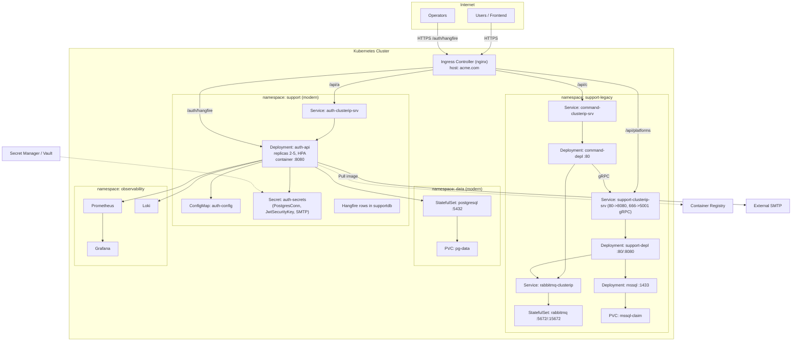
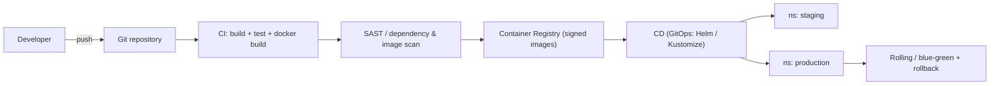

# Infrastructure & Deployment Topology

> **Part 4 of 4** — split from [`ARCHITECTURE.md`](ARCHITECTURE.md).
> **Status:** AS-IS manifests (`Launcher/K8S`) plus TO-BE recommendations.
> **Scope:** Kubernetes topology, workloads, routing, configuration/secrets, delivery pipeline, observability, and security hardening.

This document shows how the application containers, database, and external services interact within the deployment environment.

**Related:** [Database Model](01-DATABASE-MODEL.md) · [Component Architecture](02-COMPONENT-ARCHITECTURE.md) · [Data Flow & Security](03-DATA-FLOW-SECURITY.md)

---

## 4.1 Cluster topology

## 4.2 Workloads, routing, and configuration

| Workload | Image / Source | Replicas | Ports | Config | Probes |
|---|---|---|---|---|---|
| `auth-api` | `Support.Auth.Id` (needs Dockerfile — TO-BE) | 2–5 + HPA | 8080 (HTTP), TLS at ingress | `auth-config` (CM), `auth-secrets` (Secret) | `/health/live`, `/health/ready` (TO-BE) |
| `postgresql` | `postgres:16` (or managed DB) | 1 (StatefulSet) | 5432 | Secret (credentials) + PVC | `pg_isready` |
| `support-depl` | `Support.Platform` (`Support/Dockerfile`) | 1–2 | 8080 (web), 5001 (gRPC) | CM + Secret | `tcp` probes |
| `command-depl` | `Command` (`Command/Dockerfile`) | 1–2 | 80 | CM + Secret | `tcp` probes |
| `rabbitmq` | `rabbitmq:4.1-management` | 1 | 5672, 15672 | Secret + PVC | `rabbitmq-diagnostics` |
| `mssql` | `mssql/server:2022-latest` | 1 | 1433 | Secret | `tcp` probes |

**Ingress routing (TO-BE, single host recommended):**

| Path | Backend |
|---|---|
| `/api/a/*` | `auth-clusterip-srv:8080` |
| `/auth/hangfire*` | `auth-clusterip-srv:8080` (BasicAuth + HTTPS) |
| `/api/c/*` | `command-clusterip-srv:80` |
| `/api/platforms/*` | `support-clusterip-srv:80` |

**Configuration & secrets (TO-BE):**
- Inject `ConnectionStrings__PostgresConn`, `JwtSettings__*`, `Smtp__*`, `HangfireDashboard__*` from Secrets (never commit signing keys — **AS-IS risk**: JWT `SecurityKey` and DB/SMTP passwords are in `appsettings.json`).
- Add `.env`/CI secret injection; use External Secrets Operator or Vault.
- Hangfire dashboard: BasicAuth + `Ssl=true`, `SslRedirect=true`, and restrict by NetworkPolicy/ingress allow-list in production.

## 4.3 Environments & delivery pipeline (TO-BE)

- Per-environment namespaces (`staging`, `production`) or clusters.
- Migrations run as a **Job** (init container / Job) using `dotnet ef database update` before rollout; or a migration bundle.
- Add Helm/Kustomize overlays for dev/stage/prod; keep existing raw manifests in `Launcher/K8S/` as the legacy baseline.

## 4.4 Observability, resilience, scaling

- **Logging:** structured (`ILogger`); ship to Loki/ELK. `ErrorResponse.TraceId` correlates with traces.
- **Tracing/metrics:** OpenTelemetry → OTLP → Prometheus/Grafana (TO-BE; not present AS-IS).
- **Health:** add `/health/live` and `/health/ready` (DB + Hangfire checks).
- **Resilience:** Hangfire `AutomaticRetry` (5 attempts) already on email jobs; add idempotency keys; outbox for at-least-once.
- **Scaling:** HPA on CPU/RPS for `auth-api`; Hangfire workers scale via `Hangfire:WorkerCount` (AS-IS: 5 prod / 1 dev).
- **Graceful shutdown:** pass `CancellationToken` through handlers; drain Hangfire on SIGTERM.

## 4.5 Security hardening checklist (TO-BE)

| Area | Action |
|---|---|
| Secrets | Move JWT key, DB and SMTP credentials out of `appsettings.json` into Secret/Vault; rotate. |
| JWT | Consider RS256 (asymmetric) so resource services validate with public key only. |
| Refresh tokens | Store `TokenHash` (SHA-256); rotate + reuse-detection (revoke family on replay). |
| Admin endpoints | `RoleController.create` / `assign-role` currently lack `[Authorize]` — add `[Authorize(Policy="Admin")]`/permission. |
| Identity managers | `RoleController` uses `RoleManager<IdentityRole>`/`UserManager<User>` but DbContext is not `IdentityDbContext` — reconcile or remove. |
| Transport | Enforce HTTPS (`UseHttpsRedirection`, HSTS); TLS termination at ingress. |
| Hangfire dashboard | Strong basic auth + HTTPS + network allow-list; consider SSO. |
| Input/OWASP | Validate DTOs; rate-limit auth endpoints (not present AS-IS). |

