# System Architecture Blueprint — Support Platform

> **Version:** 1.0
> **Status:** Target Architecture (To-Be) with As-Is baseline
> **Date:** 2026-10-19
> **Scope:** Entire solution in this repository (both subsystems)
> **Audience:** Engineering, Platform/DevOps, Security, Technical Product
> **Author:** Enterprise Architecture

---

## 0. How to read this document

This blueprint distinguishes two states:

| Marker | Meaning |
|---|---|
| **AS-IS** | What exists in the repository today (verified from source). |
| **TO-BE** | The production-ready target design. New elements required by the chosen decisions (multi-tenancy, fine-grained RBAC) are marked TO-BE. |

**Confirmed design decisions (from stakeholder):**

1. **Scope:** entire solution (modern `net10.0` subsystem **and** legacy `net9.0` subsystem).
2. **Multi-tenancy:** Shared database + `TenantId` discriminator (PostgreSQL row-level tenancy).
3. **Deployment target:** Kubernetes.
4. **Authorization:** RBAC with fine-grained Permissions (`Permissions` + `RolePermissions`).
5. **This document lives at:** `ARCHITECTURE.md` (repository root).

---

## 1. Executive Summary

The repository contains **two independent subsystems** that must not be conflated:

1. **"Support Pro-Document" — Modern Identity & Notification subsystem (`net10.0`)**
   - `Support.Auth.Id` — the deployable identity/access API (JWT bearer, CQRS/DDD, EF Core + PostgreSQL, Hangfire).
   - `Support.Notification.Id` — a reusable email/notification **module** (Hangfire queue + MailKit SMTP), **hosted inside** `Support.Auth.Id`.
   - `Support.Auth.Client`, `Support.Notification.Client` — shared **contract libraries** (DTOs/interfaces), no executable.
   - Data store: **PostgreSQL** (`supportdb`) shared with Hangfire storage.

2. **Legacy microservices (`net9.0`)**
   - `Support.Platform` — platform catalog API, gRPC **server**, RabbitMQ **publisher**, SQL Server/InMemory.
   - `Command` — child "commands" API, RabbitMQ **consumer**, gRPC **client**, InMemory.
   - Communication: **gRPC (sync)** + **RabbitMQ (async, fanout `trigger`)**.

**AS-IS gaps addressed by this blueprint:** no multi-tenancy, roles-only authorization (no permission model), plaintext JWT signing key in `appsettings`, refresh tokens stored in plaintext, missing authorization attributes on some admin endpoints, and the notification module still coupled inside the Auth host.

**TO-BE outcome:** a Kubernetes-deployable, multi-tenant identity platform with fine-grained RBAC, hardened token handling, a transactional outbox, and a cleanly separated notification worker.

---

## 2. Technology Stack (AS-IS)

### 2.1 Modern subsystem (`net10.0`)

| Concern | Technology |
|---|---|
| Runtime | .NET 10 (`Microsoft.NET.Sdk.Web`) |
| API | ASP.NET Core, Controllers, OpenAPI (`Microsoft.AspNetCore.OpenApi`) |
| Auth | `Microsoft.AspNetCore.Authentication.JwtBearer` (HMAC-SHA256), `System.IdentityModel.Tokens.Jwt` |
| Identity primitives | `Microsoft.AspNetCore.Identity.EntityFrameworkCore` (managers referenced in `RoleController`) |
| ORM | EF Core 10 (`Microsoft.EntityFrameworkCore`) |
| Database | **PostgreSQL** via `Npgsql.EntityFrameworkCore.PostgreSQL` |
| Background jobs | **Hangfire** (`Hangfire.AspNetCore`, `Hangfire.PostgreSql`, `Hangfire.Dashboard.BasicAuthorization`) |
| Password hashing | `BCrypt.Net-Next` |
| Token hashing | SHA-256 (application-level, `AppHasher`) |
| Mapping | `Riok.Mapperly` (source generator) |
| Email | `MailKit` / `MimeKit` |
| Config | `appsettings*.json`, User Secrets, Options pattern (`ValidateOnStart`) |

### 2.2 Legacy subsystem (`net9.0`)

| Concern | Technology |
|---|---|
| Runtime | .NET 9 |
| API | ASP.NET Core Controllers, Swashbuckle (Swagger) |
| Sync comms | **gRPC** (`Grpc.AspNetCore`, `Grpc.Net.Client`, `Google.Protobuf`) |
| Async comms | **RabbitMQ** (`RabbitMQ.Client`) |
| ORM | EF Core 9 (InMemory in dev; **SQL Server** in prod for Platform) |
| Mapping | AutoMapper |
| Hosting | Docker + **Kubernetes** manifests in `Launcher/K8S/` |

### 2.3 Deployment/infra (AS-IS)

- Kubernetes manifests: `Launcher/K8S/` (`*-depl.yaml`, `ingress-srv.yaml`, `rabbitmq-depl.yaml`, `mssql-plat-depl.yaml`, `local-pvc.yaml`).
- Ingress host `acme.com`; services `command-clusterip-srv`, `support-clusterip-srv`.
- **No** Dockerfile for the modern Auth/Notification services, and **no** CI/CD pipelines found.

---

## 3. Architecture Principles & Patterns

- **DDD (tactical):** rich domain entities (`User`, `Role`, `RefreshToken`) with static factories and invariant guards; value objects (`EmailVerification`, `PasswordReset`) persisted via EF `OwnsOne`.
- **CQRS (lightweight):** `ICommandHandler<…>` / `ICommandQueryHandler<…, TResult>` with one handler per use case; controllers dispatch to handlers (no business logic in controllers).
- **Clean exception handling:** domain throws typed exceptions (`BusinessValidationException`, `ConflictException`, `NotFoundException`, `UnauthorizedException`); a single `ExceptionMiddleware` maps them to HTTP status codes. Transactions are centralized in the repository (`ExecuteInTransactionAsync`), not scattered `try/catch`.
- **Repository + Unit of Work:** `IAuthRepositories : IBaseRepositories` exposes data access and a single transaction boundary.
- **Contract libraries:** cross-module communication via `Support.*.Client` interfaces (`IEmailQueueServiceClient`, `INotificationClient`).
- **Transactional Outbox (partially built):** `OutboxMessage` entity + `OutboxWorkerService` exist but are **disabled**. Target: promote to the primary reliability mechanism for side effects.

---

# 4. Section 1 — Physical Database Model (ERD)

## 4.1 Bounded contexts and data ownership

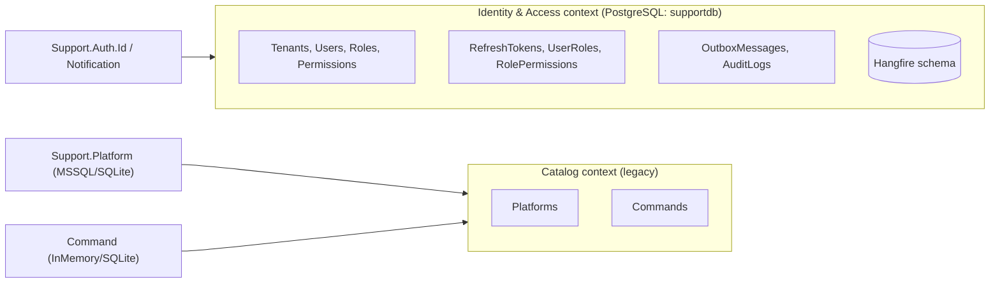

- **AS-IS:** one shared PostgreSQL database `supportdb` for Auth + Hangfire; Platform on SQL Server; Command on InMemory.
- **TO-BE:** multi-tenant **shared database with `TenantId` discriminator** in the Identity & Access context. Catalog context remains a separate legacy store (recommended: migrate `Command` to a real database per environment).

## 4.2 TO-BE ERD — Identity & Access (multi-tenant, RBAC + permissions)

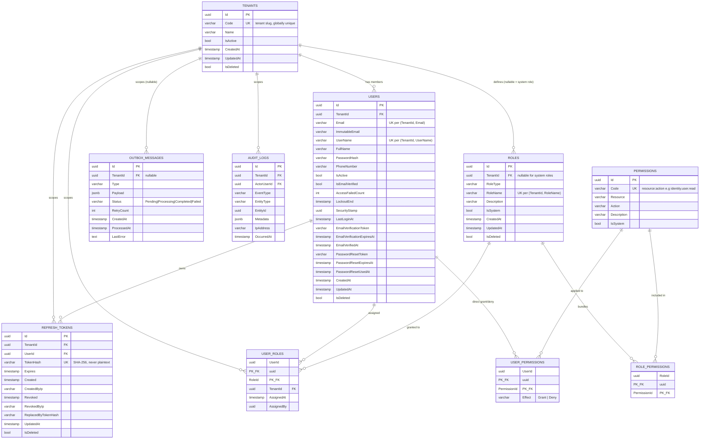

> Note: `USER_ROLES`, `ROLE_PERMISSIONS`, `USER_PERMISSIONS` use **composite primary keys** (shown with `PK_FK`). Mermaid cannot express composite keys visually; see the catalog below for exact PK/FK/index definitions.

## 4.3 Table catalog (TO-BE, PostgreSQL)

### `Tenants` (system-level, not tenant-scoped)
| Column | Type | Key/Constraint |
|---|---|---|
| Id | uuid | **PK** |
| Code | varchar(50) | **Unique**, not null (slug) |
| Name | varchar(150) | not null |
| IsActive | boolean | not null, default true |
| CreatedAt / UpdatedAt | timestamptz | |
| IsDeleted | boolean | not null, default false; partial index |

### `Users` (tenant-scoped)
| Column | Type | Key/Constraint |
|---|---|---|
| Id | uuid | **PK** |
| TenantId | uuid | **FK → Tenants(Id)**, not null |
| Email | varchar(100) | not null; **unique (TenantId, Email) WHERE IsDeleted = false** |
| ImmutableEmail | varchar(100) | not null (audit of original email) |
| UserName | varchar(50) | not null; **unique (TenantId, UserName) WHERE IsDeleted = false** |
| FullName | varchar(100) | not null |
| PasswordHash | varchar(500) | not null (BCrypt) |
| PhoneNumber | varchar(30) | null |
| IsActive | boolean | not null (account enabled) |
| IsEmailVerified | boolean | **derived** — recommend dropping; use `EmailVerifiedAt` |
| AccessFailedCount | int | not null, default 0 |
| LockoutEnd | timestamptz | null |
| SecurityStamp | uuid | not null (session invalidation) |
| LastLoginAt | timestamptz | null |
| EmailVerificationToken | varchar(225) | owned value object (`EmailVerification`) |
| EmailVerificationExpiresAt | timestamptz | owned |
| EmailVerifiedAt | timestamptz | owned |
| PasswordResetToken | varchar(225) | owned value object (`PasswordReset`) |
| PasswordResetExpiresAt | timestamptz | owned |
| PasswordResetUsedAt | timestamptz | owned |
| CreatedAt / UpdatedAt | timestamptz | |
| IsDeleted | boolean | soft delete; filtered unique indexes above |

Indexes: `UX_Users_Tenant_Email (TenantId, Email) WHERE IsDeleted=false`, `UX_Users_Tenant_UserName (TenantId, UserName) WHERE IsDeleted=false`, `IX_Users_TenantId`.

### `Roles` (tenant-scoped, with system roles)
| Column | Type | Key/Constraint |
|---|---|---|
| Id | uuid | **PK** |
| TenantId | uuid | **FK → Tenants(Id)**, nullable for `IsSystem = true` |
| RoleType | varchar(50) | not null |
| RoleName | varchar(100) | not null; **unique (TenantId, RoleName) WHERE IsDeleted=false** |
| Description | varchar(100) | |
| IsSystem | boolean | not null (global/shared role) |
| timestamps + IsDeleted | | |

### `Permissions` (global catalog)
| Column | Type | Key/Constraint |
|---|---|---|
| Id | uuid | **PK** |
| Code | varchar(100) | **Unique**, not null — `resource:action` |
| Resource | varchar(50) | not null |
| Action | varchar(50) | not null |
| Description | varchar(200) | |
| IsSystem | boolean | not null |

Seed examples: `identity.user.read`, `identity.user.write`, `identity.role.manage`, `identity.permission.manage`, `audit.read`.

### `UserRoles` (explicit M:N, replaces implicit `RoleUser`)
| Column | Type | Key/Constraint |
|---|---|---|
| UserId | uuid | **PK**, **FK → Users(Id)** (Cascade) |
| RoleId | uuid | **PK**, **FK → Roles(Id)** (Restrict) |
| TenantId | uuid | **FK → Tenants(Id)** |
| AssignedAt | timestamptz | not null, default now() |
| AssignedBy | uuid | null, FK → Users(Id) (audit) |

Index: `IX_UserRoles_TenantId`, `IX_UserRoles_RoleId`.

### `RolePermissions` / `UserPermissions`
- `RolePermissions(RoleId PK/FK, PermissionId PK/FK)` — role → permission bundle.
- `UserPermissions(UserId PK/FK, PermissionId PK/FK, Effect)` — optional direct grant/deny; `Effect ∈ {Grant, Deny}`, `Deny` overrides `Grant`.

### `RefreshTokens` (tenant-scoped, hardened)
| Column | Type | Key/Constraint |
|---|---|---|
| Id | uuid | **PK** |
| TenantId | uuid | **FK → Tenants(Id)** |
| UserId | uuid | **FK → Users(Id)**, `ON DELETE RESTRICT` |
| TokenHash | varchar(500) | **Unique**, SHA-256 of the raw token (never plaintext) |
| Expires | timestamptz | not null |
| Created | timestamptz | not null |
| CreatedByIp | varchar(100) | not null |
| Revoked | timestamptz | null |
| RevokedByIp | varchar(100) | null |
| ReplacedByTokenHash | varchar(500) | null (rotation chain) |
| UpdatedAt | timestamptz | |
| IsDeleted | boolean | (add query filter, or drop the column) |

### `OutboxMessages` (transactional outbox)
Same as AS-IS plus **`TenantId`** (nullable). Indexes: `IDX_OutboxMessages_Type`, `IDX_OutboxMessages_Status_CreatedAt`, plus `IX_OutboxMessages_TenantId`.

### `AuditLogs` (new, TO-BE)
Append-only security/action audit. Indexes on `(TenantId, OccurredAt)` and `(ActorUserId)`.

### Hangfire schema
Managed by Hangfire.PostgreSql in the same database — **do not** hand-modify. Consider a dedicated schema (`hangfire`) and a separate database for isolation in production.

## 4.4 Multi-tenancy strategy (TO-BE)

**Model:** shared database, `TenantId` column, enforced at two layers:

1. **EF Core global query filters** — every tenant-scoped entity implements `ITenantScoped { Guid TenantId }`; `AppDbContext.OnModelCreating` applies `HasQueryFilter(e => e.TenantId == _tenantContext.TenantId)`.
2. **Write enforcement** — `SaveChanges` interceptor stamps `TenantId` on inserts and rejects cross-tenant writes.

**Tenant resolution (request scope):** resolve tenant from (in priority order) JWT `tenant_id` claim → request header `X-Tenant-Id` (for anonymous endpoints) → subdomain → default. Expose via `ITenantContext` (scoped).

**Uniqueness:** all business unique keys become **composite with `TenantId`** (email, username, role name) and use **filtered indexes** (`WHERE IsDeleted = false`) to avoid the soft-delete vs unique-index conflict.

**System roles/permissions:** `Roles.TenantId = NULL` + `IsSystem = true` are shared; user-created roles are tenant-scoped.

## 4.5 Access control model (TO-BE)

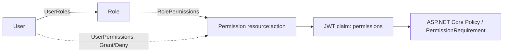

- **RBAC core:** users → roles → permissions.
- **Fine-grained overrides:** `UserPermissions` with `Deny` precedence.
- **Token claims:** on login, flatten effective permissions into a `permissions` claim (list) and roles into `role` claims.
- **Enforcement:** a `PermissionAuthorizationHandler` + `[HasPermission("identity.user.read")]` attribute; existing `"Admin"`/`"User"` policies retained for backward compatibility.
- **Tenant isolation in authorization:** permission checks are scoped to the caller's `TenantId`.

## 4.6 AS-IS → TO-BE delta (Identity context)

| Item | AS-IS | TO-BE |
|---|---|---|
| Multi-tenancy | none | `Tenants` + `TenantId` on Users/Roles/RefreshTokens/Outbox/UserRoles |
| Join table | implicit `RoleUser` | explicit `UserRoles` (+ AssignedAt/AssignedBy) |
| Permissions | none | `Permissions`, `RolePermissions`, `UserPermissions` |
| Refresh token storage | plaintext `Token` | `TokenHash` (SHA-256) |
| Email verified flag | bool + `EmailVerifiedAt` (dup) | derive from `EmailVerifiedAt` |
| Unique indexes | `Email`, `UserName` (global) | composite `(TenantId, X)` + filtered `WHERE IsDeleted=false` |
| Audit | none | `AuditLogs` |
| Outbox | entity exists, worker disabled | promoted to active delivery mechanism |

## 4.7 ERD — Catalog context (legacy, AS-IS)

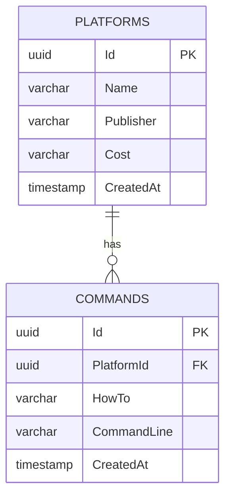

> `Support.Platform` uses SQL Server (prod) / InMemory (dev); `Command` uses InMemory. TO-BE recommendation: give both a durable store (PostgreSQL to consolidate the stack) and apply `TenantId` only if the catalog is exposed per-tenant.

---

# 5. Section 2 — Component Architecture (C4 Level 3)

## 5.1 C4 Level 1 — System Context

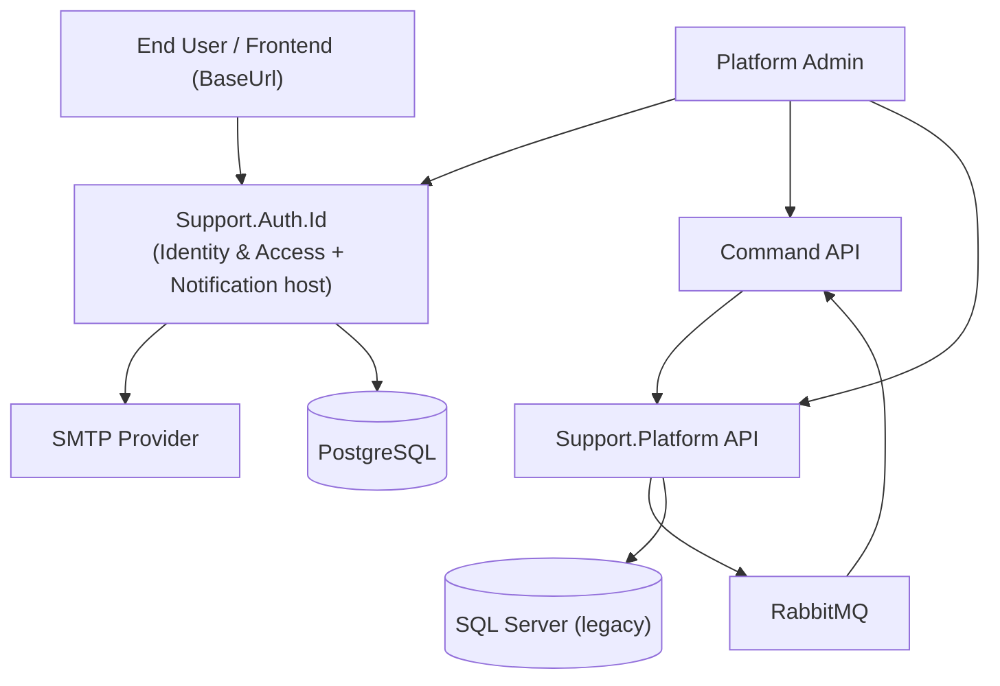

## 5.2 C4 Level 3 — `Support.Auth.Id` (+ hosted Notification module)

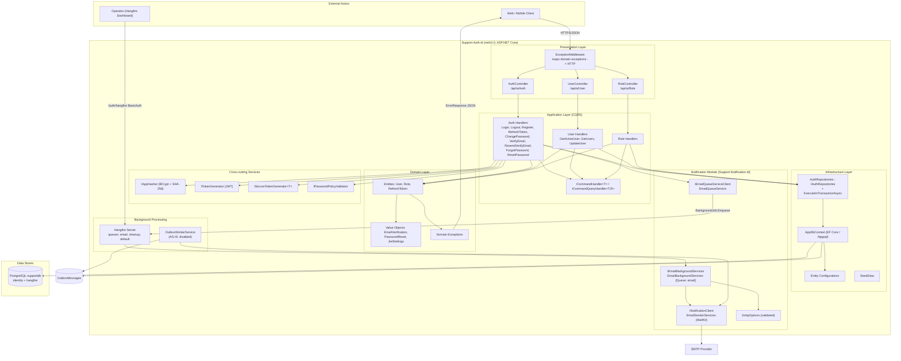

**Component responsibilities**

| Component | Responsibility | Key files |
|---|---|---|
| `ExceptionMiddleware` | Global error handling; typed exception → HTTP (404/409/401/400/500) + `ErrorResponse` with TraceId | `src/Middleware/ExceptionMiddleware.cs` |
| Controllers | HTTP boundary, model validation, dispatch to handlers; no business logic | `src/Controller/*.cs` |
| CQRS Handlers | Orchestration, transaction boundary (`ExecuteInTransactionAsync`) | `src/Features/Handler/**` |
| Domain entities | Invariants, factories, state transitions | `src/Domain/Entity/*.cs` |
| Value objects | Immutable sub-values, owned by `User` | `src/Domain/ValueObject/*.cs` |
| `AuthRepositories` | EF Core data access + transaction | `src/Repositories/*` |
| `AppDbContext` | EF model, query filters, configurations | `src/Repositories/Data/*` |
| `TokenGenerator` | JWT access token + refresh token creation | `src/Services/Security/TokenGenerator.cs` |
| `AppHasher` | BCrypt (password) + SHA-256 (token hash) | `src/Services/Security/PasswordHasher.cs` |
| `EmailQueueService` | Enqueue Hangfire email job | `Support.Notification.Id/src/Services/EmailQueueService.cs` |
| `EmailBackgroundServices` | Hangfire job `[Queue("email")]` → MailKit | `.../BackgroundServices/EmailBackgroundServices.cs` |
| `EmailSenderServices` | SMTP send (`INotificationClient`) | `.../Services/EmailSenderServices.cs` |
| `Hangfire Server` | Executes queued jobs; dashboard at `/auth/hangfire` | `Program.cs` |
| `OutboxWorkerService` | Poll outbox, deliver via `INotificationClient` | `src/Services/BackgroundServices/OutboxWorkerService.cs` |

## 5.3 C4 Level 3 — Legacy subsystem (`Support.Platform` + `Command`)

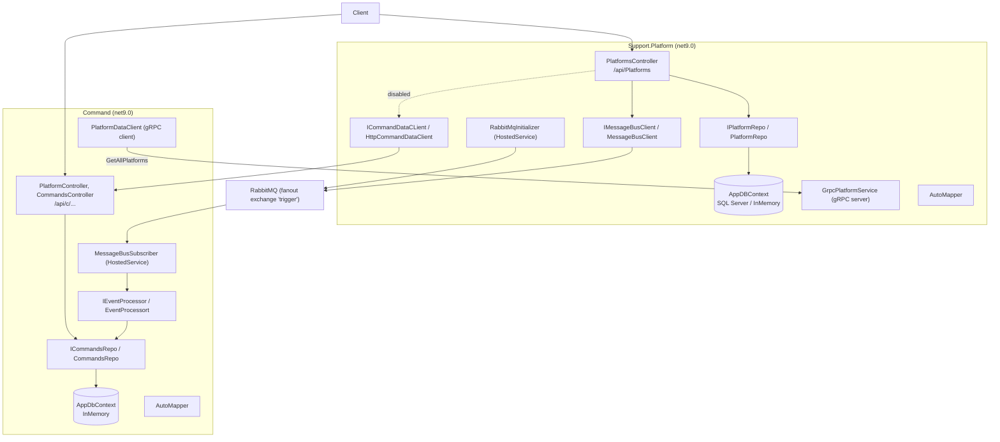

---

# 6. Section 3 — Data Flow & Security Sequence Diagrams

## 6.1 Login + token issuance (AS-IS logic, TO-BE adds `tenant_id` + `permissions` claims)

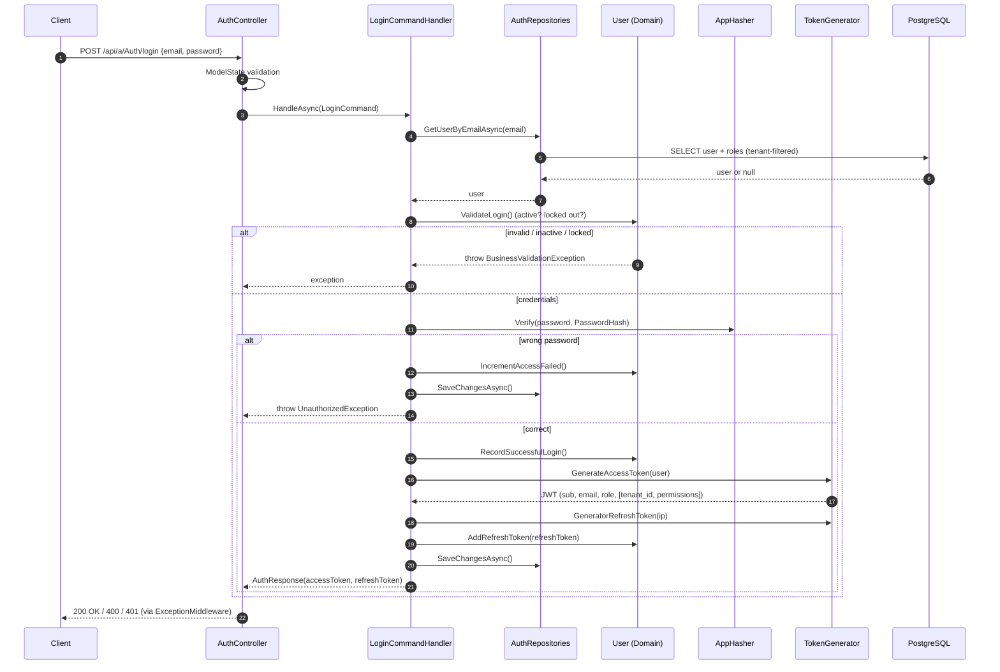

## 6.2 Authorization check on a protected endpoint (RBAC + permission)

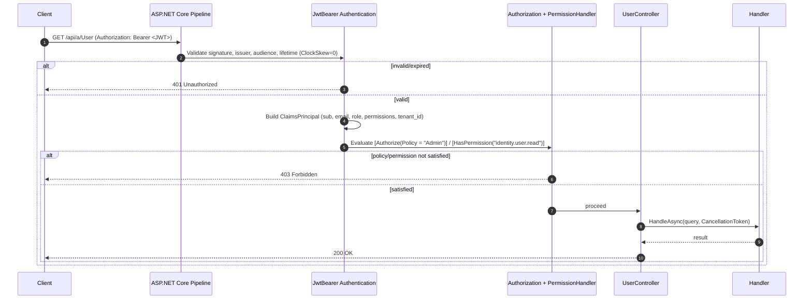

## 6.3 Forgot password (transactional side-effect via Hangfire)

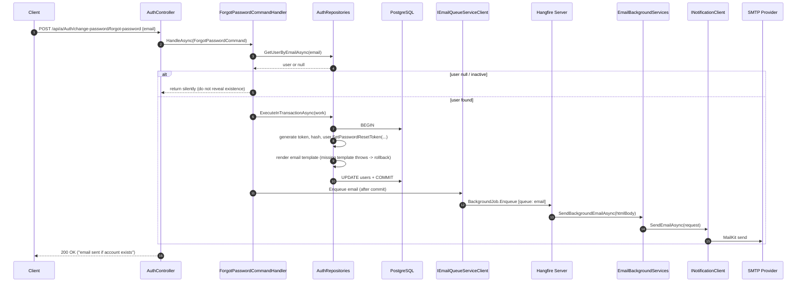

> Reliability note: the enqueue happens **after** commit. TO-BE strengthens this with the **transactional outbox** (write `OutboxMessage` in the same transaction; a worker publishes to Hangfire), eliminating the dual-write window.

## 6.4 Refresh token rotation

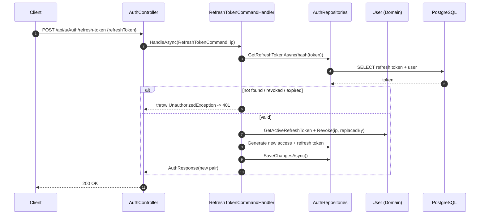

## 6.5 Registration + email verification

```mermaid
sequenceDiagram
  autonumber
  participant C as Client
  participant AC as AuthController
  participant RH as RegisterCommandHandler
  participant R as AuthRepositories
  participant DB as PostgreSQL
  participant HF as Hangfire (email queue)
  participant SMTP as SMTP

  C->>AC: POST /api/a/Auth/register
  AC->>RH: HandleAsync(RegisterCommand)
  RH->>R: IsUserEmailExists / IsUsernameExists
  RH->>R: ExecuteInTransactionAsync
  R->>DB: BEGIN; INSERT user + role; set verification token; COMMIT
  RH->>HF: enqueue verification email
  HF->>SMTP: send
  AC-->>C: 200 OK
  C->>AC: POST /api/a/Auth/verify-email {token}
  AC->>R: GetUserByEmailVerificationTokenAsync(token)
  AC->>DB: UPDATE email verified
  AC-->>C: 200 OK
```

## 6.6 Cross-service flow (Platform → RabbitMQ → Command, and gRPC sync)

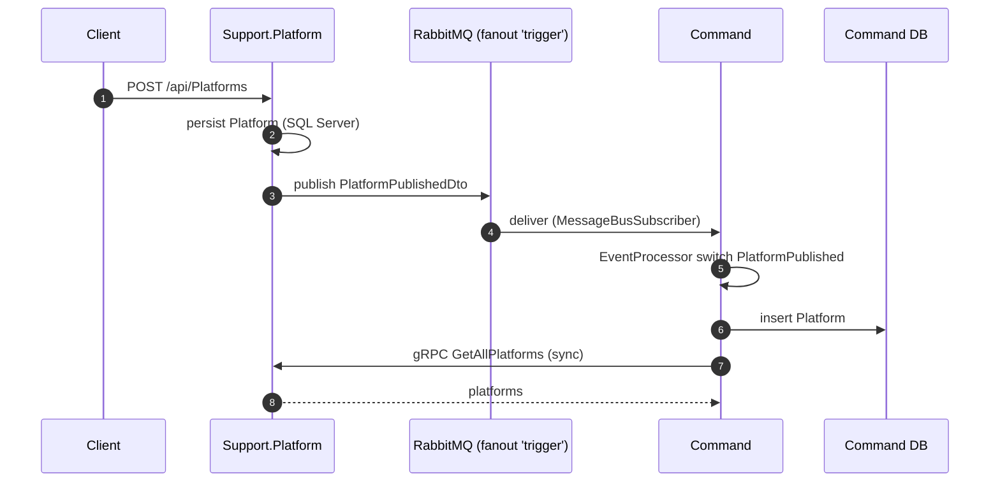

---

# 7. Section 4 — Infrastructure & Deployment Topology (Kubernetes)

## 7.1 Cluster topology

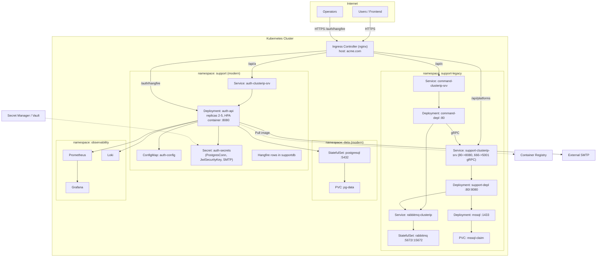

## 7.2 Workloads, routing, and configuration

| Workload | Image / Source | Replicas | Ports | Config | Probes |
|---|---|---|---|---|---|
| `auth-api` | `Support.Auth.Id` (needs Dockerfile — TO-BE) | 2–5 + HPA | 8080 (HTTP), TLS at ingress | `auth-config` (CM), `auth-secrets` (Secret) | `/health/live`, `/health/ready` (TO-BE) |
| `postgresql` | `postgres:16` (or managed DB) | 1 (StatefulSet) | 5432 | Secret (credentials) + PVC | `pg_isready` |
| `support-depl` | `Support.Platform` (`Support/Dockerfile`) | 1–2 | 8080 (web), 5001 (gRPC) | CM + Secret | `tcp` probes |
| `command-depl` | `Command` (`Command/Dockerfile`) | 1–2 | 80 | CM + Secret | `tcp` probes |
| `rabbitmq` | `rabbitmq:4.1-management` | 1 | 5672, 15672 | Secret + PVC | `rabbitmq-diagnostics` |
| `mssql` | `mssql/server:2022-latest` | 1 | 1433 | Secret | `tcp` probes |

**Ingress routing (TO-BE, single host recommended):**

| Path | Backend |
|---|---|
| `/api/a/*` | `auth-clusterip-srv:8080` |
| `/auth/hangfire*` | `auth-clusterip-srv:8080` (BasicAuth + HTTPS) |
| `/api/c/*` | `command-clusterip-srv:80` |
| `/api/platforms/*` | `support-clusterip-srv:80` |

**Configuration & secrets (TO-BE):**
- Inject `ConnectionStrings__PostgresConn`, `JwtSettings__*`, `Smtp__*`, `HangfireDashboard__*` from Secrets (never commit signing keys — **AS-IS risk**: JWT `SecurityKey` and DB/SMTP passwords are in `appsettings.json`).
- Add `.env`/CI secret injection; use External Secrets Operator or Vault.
- Hangfire dashboard: BasicAuth + `Ssl=true`, `SslRedirect=true`, and restrict by NetworkPolicy/ingress allow-list in production.

## 7.3 Environments & delivery pipeline (TO-BE)

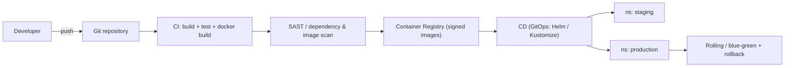

- Per-environment namespaces (`staging`, `production`) or clusters.
- Migrations run as a **Job** (init container / Job) using `dotnet ef database update` before rollout; or a migration bundle.
- Add Helm/Kustomize overlays for dev/stage/prod; keep existing raw manifests in `Launcher/K8S/` as the legacy baseline.

## 7.4 Observability, resilience, scaling

- **Logging:** structured (`ILogger`); ship to Loki/ELK. `ErrorResponse.TraceId` correlates with traces.
- **Tracing/metrics:** OpenTelemetry → OTLP → Prometheus/Grafana (TO-BE; not present AS-IS).
- **Health:** add `/health/live` and `/health/ready` (DB + Hangfire checks).
- **Resilience:** Hangfire `AutomaticRetry` (5 attempts) already on email jobs; add idempotency keys; outbox for at-least-once.
- **Scaling:** HPA on CPU/RPS for `auth-api`; Hangfire workers scale via `Hangfire:WorkerCount` (AS-IS: 5 prod / 1 dev).
- **Graceful shutdown:** pass `CancellationToken` through handlers; drain Hangfire on SIGTERM.

## 7.5 Security hardening checklist (TO-BE)

| Area | Action |
|---|---|
| Secrets | Move JWT key, DB and SMTP credentials out of `appsettings.json` into Secret/Vault; rotate. |
| JWT | Consider RS256 (asymmetric) so resource services validate with public key only. |
| Refresh tokens | Store `TokenHash` (SHA-256); rotate + reuse-detection (revoke family on replay). |
| Admin endpoints | `RoleController.create` / `assign-role` currently lack `[Authorize]` — add `[Authorize(Policy="Admin")]`/permission. |
| Identity managers | `RoleController` uses `RoleManager<IdentityRole>`/`UserManager<User>` but DbContext is not `IdentityDbContext` — reconcile or remove. |
| Transport | Enforce HTTPS (`UseHttpsRedirection`, HSTS); TLS termination at ingress. |
| Hangfire dashboard | Strong basic auth + HTTPS + network allow-list; consider SSO. |
| Tenancy | JWT `tenant_id` validated against `Tenants`; guard against tenant spoofing via headers. |
| Input/OWASP | Validate DTOs; rate-limit auth endpoints (not present AS-IS). |

---

# 8. Cross-Cutting Concerns

- **Transactions:** single boundary in `ExecuteInTransactionAsync` (begin → work → save → commit; rollback on throw). Side effects (email) are enqueued after commit.
- **Outbox (target):** for exactly-once delivery semantics of integration events; the `OutboxMessages` table + worker already exist and should be enabled.
- **Idempotency:** background jobs and outbox consumers must be idempotent.
- **Multi-tenancy:** query filters + write stamping + composite keys; a tenant must never read another tenant's rows.
- **Contract libraries:** `Support.*.Client` are the anti-corruption seam between modules/services; version them.

---

# 9. Risks & Recommended Actions (prioritized)

| # | Risk / Gap | Severity | Recommendation |
|---|---|---|---|
| 1 | No multi-tenancy in data model | High | Introduce `Tenants` + `TenantId`, query filters, composite unique keys (this blueprint). |
| 2 | Authorization is roles-only; some admin endpoints unprotected | High | Add permission model; enforce `[Authorize]`/`[HasPermission]` everywhere. |
| 3 | JWT signing key & credentials committed in `appsettings.json` | Critical | Move to secrets; rotate; adopt RS256. |
| 4 | Refresh tokens stored plaintext | High | Store SHA-256 hash; add rotation/reuse detection. |
| 5 | Dual-write (DB commit + Hangfire enqueue) | Medium | Enable transactional outbox. |
| 6 | Notification module coupled inside Auth host | Medium | Extract to its own deployment (worker) when load/ownership demands. |
| 7 | Two heterogeneous subsystems (PostgreSQL vs SQL Server/InMemory) | Medium | Consolidate persistence; migrate `Command` off InMemory. |
| 8 | No Dockerfile/CI for modern services | Medium | Add multi-stage Dockerfiles + CI/CD + migration job. |
| 9 | Soft-delete vs unique index conflict | Medium | Filtered unique indexes `WHERE IsDeleted = false`. |
| 10 | No health checks, rate limiting, or OTel | Medium | Add probes, limiter on auth endpoints, OTel pipeline. |
| 11 | Redundant `IsEmailVerified` vs `EmailVerifiedAt` | Low | Derive one from the other. |
| 12 | Inconsistent table naming (`OutboxMessage`, `RoleUser`) | Low | Standardize (`OutboxMessages`, `UserRoles`). |

---

# 10. Open Decisions & Roadmap

**Open decisions**
1. Tenant resolution precedence (JWT claim vs subdomain vs header) for pre-auth endpoints.
2. Whether `Users.TenantId` may change (tenant transfer) or is immutable.
3. Permission catalog governance (who seeds/edits `Permissions`).
4. JWT algorithm migration (HS256 → RS256) and key distribution.
5. Legacy subsystem: keep SQL Server, or migrate to PostgreSQL to unify.

**Suggested roadmap**
- **Phase 1 (Foundation):** secrets hardening, Dockerfiles + CI, health checks, enable HTTPS/HSTS, protect admin endpoints.
- **Phase 2 (Security):** refresh-token hashing + rotation, permission model + policy handler, audit logging.
- **Phase 3 (Tenancy):** `Tenants` + `TenantId`, query filters, composite keys, tenant resolution, data backfill for a default tenant.
- **Phase 4 (Reliability):** activate transactional outbox; extract notification worker; add rate limiting + OTel.
- **Phase 5 (Consolidation):** unify persistence, Helm/Kustomize overlays, staging/prod GitOps.

---

## Appendix A — Key source map

| Concern | Path |
|---|---|
| Auth host entrypoint | `Support.Auth.Id/Program.cs` |
| Auth DI | `Support.Auth.Id/DI.cs` |
| Controllers | `Support.Auth.Id/src/Controller/{Auth,User,Role}Controller.cs` |
| CQRS handlers | `Support.Auth.Id/src/Features/Handler/**` |
| Domain entities | `Support.Auth.Id/src/Domain/Entity/*.cs` |
| Value objects | `Support.Auth.Id/src/Domain/ValueObject/*.cs` |
| Repositories | `Support.Auth.Id/src/Repositories/{AuthRepositories,BaseRepositories}.cs` |
| EF config | `Support.Auth.Id/src/Repositories/Data/Configuration/*.cs` |
| Migrations | `Support.Auth.Id/src/Migrations/*` |
| Exception middleware | `Support.Auth.Id/src/Middleware/ExceptionMiddleware.cs` |
| Security services | `Support.Auth.Id/src/Services/Security/*.cs` |
| Notification module | `Support.Notification.Id/{DI.cs,Program.cs,src/Services/**}` |
| Contracts | `Support.Notification.Client/Contract/*.cs`, `Support.Auth.Client/DTOs/**` |
| Outbox | `Support.Auth.Id/src/Domain/Entity/OutboxMessage.cs`, `src/Services/BackgroundServices/OutboxWorkerService.cs` |
| Legacy Platform | `Support/Support.Platform/**` |
| Legacy Command | `Command/**` |
| K8s manifests | `Launcher/K8S/*` |
| Existing docs | `README.md`, `Launcher/Doc/**` |

## Appendix B — Configuration keys (names only)

| File | Keys |
|---|---|
| `Support.Auth.Id/appsettings.json` | `Logging`, `AllowedHosts`, `ConnectionStrings:PostgresConn`, `JwtSettings:{Issuer,Audience,SecurityKey,AccessTokenExpirationMinutes,RefreshTokenExpirationDays}`, `Frontend:BaseUrl`, `HangfireDashboard:{Login,Password,Ssl,SslRedirect}` |
| `Support.Notification.Id/appsettings.json` | `Logging`, `Smtp:{Host,Port,Username,Password,SenderName,SenderEmail,EnableSsl}`, `HangfireDashboard:*`, `AllowedHosts` |
| `Support/Support.Platform/appsettings.json` | `Logging`, `AllowedHosts`, `Command`, `ConnectionStrings:SupportConnection`, `RabbitMQHost`, `RabbitMQPort`, `Kestrel:Endpoints:{Grpc,webApi}` |
| `Command/appsettings.json` | `Logging`, `RabbitMQHost`, `RabbitMQPort`, `AllowedHosts`, `GrpcPlatform` |

---

*End of blueprint. All Mermaid diagrams render on GitHub / VS Code (Mermaid Markdown Preview). ERD relationship cardinality: `||--o{` = one-to-many, `}o--o{` = many-to-many.*
